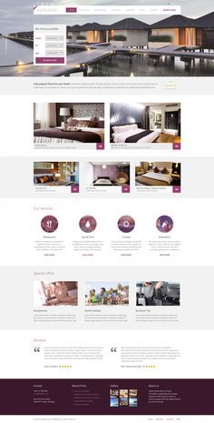
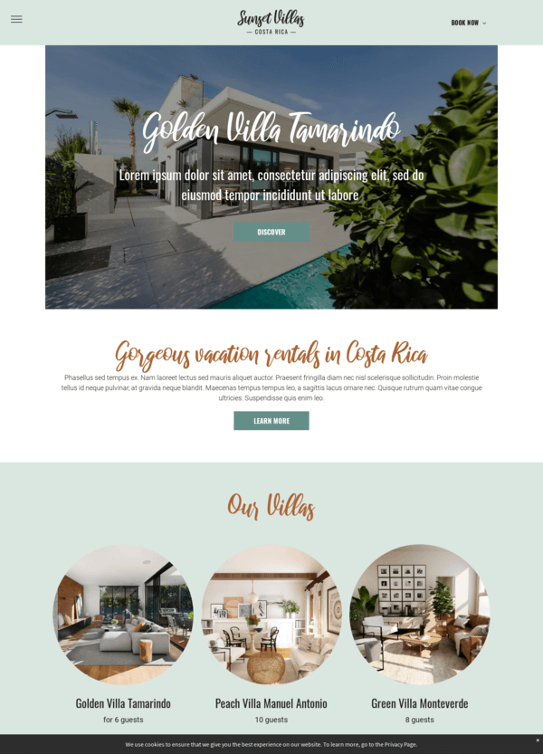

# Registros do projeto

### Prompt 1 
    Você é um desenvolvedor Frontend Senior e UX/UI Designer de luxo especialista em React, Tailwind CSS e UI para o setor imobiliário/hospitalidade. Quero criar um site elegante de reservas/apresentação de acomodações (estilo Resort, Villas ou Hotel de Luxo) combinando a estrutura visual das referências e uma paleta de cores sofisticada.

    1. PALETA DE CORES
    Aplique rigorosamente a seguinte paleta de cores no Tailwind CSS / Variáveis CSS:
    - Fundo Principal / Off-White: Porcelain (`#FFFFFA`)
    - Cor Primária / Destaque Secundário: Wine Plum (`#702632`)
    - Cor de Destaque / Botões / CTAs: Burnt Rose (`#912F40`)
    - Texto Principal / Contrastes Escuros: Black (`#080705`)
    - Fundo Secundário / Cards / Sidebar: Charcoal Blue (`#40434E`)

    2. TIPOGRAFIA E ESTILO VISUAL
    - Títulos Especiais e Destaques: Use uma fonte estilo cursiva/manuscrita 'Great Vibes' via Google Fonts para transmitir exclusividade e sensação acolhedora.
    - Textos Principais e Navegação: Fonte sans-serif limpa e moderna Inter em caixa alta e com alto espaçamento entre letras (`tracking-wider`).
    - Imagens e Molduras:
    - Utilize recortes circulares elegantes para as imagens dos quartos/villas (conforme a referência visual).
    - Adicione sombras suaves e bordas elegantes nos cards de acomodações e serviços.

    3. ESTRUTURA DO SITE (LAYOUT)
    Construa uma página inicial de alta conversão contendo:

    1. **Header / Bar de Navegação:**
    - Logo centralizada com nome refinado ("Sunset Ivory").
    - Menu simples de navegação e botão destacado de "Reservar Agora" (Book Now).

    2. **Hero Section (Capa Principal):**
    - Imagem de fundo em alta resolução de uma vila/suíte de luxo.
    - Título em fonte manuscrita elegante (ex.: "Golden Villa Tamarindo").
    - Texto de apresentação curto e um botão centralizado com estilo vazado/sólido ("Descobrir").

    3. **Seção de Acomodações ("Nossas VIllas / Suítes"):**
    - Título manuscrito destacado ("Our Villas").
    - Grade com 3 opções principais usando **molduras circulares perfeitas** para as fotos das acomodações.
    - Abaixo de cada foto circular: Nome da vila, capacidade de hóspedes (ex.: "para 6 hóspedes") e botão de detalhes.

    4. **Seção de Serviços e Experiências:**
    - Cards com ícones circulares minimalistas para serviços (ex.: Restaurante, Spa & Pool, Bar, Passeios).

    5. **Depoimentos e Avaliações:**
    - Cards limpos com aspas elegantes, textos de avaliação dos clientes e classificação por estrelas.

    6. **Rodapé (Footer):**
    - Fundo escuro em tom `Charcoal Blue` ou `Wine Plum`.
    - Links rápidos de contato, endereço, galeria de fotos e notícias recentes.

    4. REQUISITOS TÉCNICOS
    - Crie um componente único e funcional em React utilizando Tailwind CSS e ícones da biblioteca 'lucide-react'.
    - O layout deve ser totalmente responsivo (mobile, tablet e desktop).
    - Adicione transições suaves (`transition-all duration-300`) nos botões e ao passar o mouse sobre os cards.

    Por favor, gere o código completo dentro de um único Artifact do React para que eu possa visualizar e interagir com o site imediatamente!

### Prompt 2
    Atue como Desenvolvedor Frontend Senior e UX/UI Designer. 
    Quero que você ATUALIZE e EXPANDA o código React anterior do site "Sunset Ivory", mantendo exatamente a mesma identidade visual, a fonte 'Great Vibes', a fonte 'Inter' e a paleta de cores fornecida (Porcelain `#FFFFFA`, Wine Plum `#702632`, Burnt Rose `#912F40`, Black `#080705` e Charcoal Blue `#40434E`).
    Por favor, aplique as seguintes melhorias e novas funcionalidades no código:

    1. IMAGENS REAIS E DE ALTA QUALIDADE (UNSPLASH)
    Substitua todos os placeholders de imagens por URLs reais e funcionais do Unsplash em alta resolução referentes a hotéis de luxo, resorts e suítes. Utilize estes links (ou equivalentes funcionais):
    - Hero Header: https://images.unsplash.com/photo-1571896349842-33c89424de2d?auto=format&fit=crop&w=1600&q=80
    - Golden Villa Tamarindo: https://images.unsplash.com/photo-1582719478250-c89cae4dc85b?auto=format&fit=crop&w=800&q=80
    - Peach Villa Manuel Antonio: https://images.unsplash.com/photo-1618773928121-c32242e63f39?auto=format&fit=crop&w=800&q=80
    - Green Villa Monteverde: https://images.unsplash.com/photo-1566073771259-6a8506099945?auto=format&fit=crop&w=800&q=80
    - Spa & Gastronomia: https://images.unsplash.com/photo-1540555700478-4be289fbecef?auto=format&fit=crop&w=800&q=80

    2. NAVEGAÇÃO E NOVAS PÁGINAS (ESTADO SPA)
    Implemente um sistema de navegação por estado no React (`activeTab` ou `currentPage`) com as seguintes 3 telas/abas acessíveis pelo menu do Header e botões de ação:

     A. Página 1: Home / Início (Página Atual Atualizada)
    - Mantenha a estrutura existente (Hero, Our Villas com fotos circulares, Serviços e Footer).
    - **Depoimentos Fictícios Detalhados:** Adicione 3 depoimentos fictícios de hóspedes exigentes (ex.: casais em lua de mel ou executivos) com foto de perfil real, nome, origem, avaliação 5 estrelas e comentário rico sobre a experiência no resort.

     B. Página 2: Detalhes das Villas (`villas-detail`)
    - Exiba cartões/seções expandidas para cada uma das villas.
    - Para cada vila, inclua:
    - Foto principal e miniaturas.
    - Preço da diária (ex: R$ 3.800 / noite).
    - Metragem do espaço (ex: 220 m²).
    - Lista de comodidades com ícones do `lucide-react` (Piscina privativa, Vista para o mar, Wi-Fi 5G, Café da manhã gourmet, Servicio de Butler 24h, Ar condicionado).
    - Botão "Reservar esta Villa" que direciona para a Simulação de Reserva preenchendo a vila escolhida.

    C. Página 3: Simulação de Reserva Interativa (`booking-simulator`)
    Crie um formulário funcional e dinâmico contendo:
    1. Seletor de Villa (Dropdown para selecionar entre Tamarindo, Manuel Antonio ou Monteverde).
    2. Seletor de Datas (Check-in e Check-out).
    3. Número de hóspedes (Adultos e Crianças).
    4. **Serviços Extras Opcionais** (Checkboxes com preços adicionais):
    - Traslado de Helicóptero/Transfer VIP
    - Jantar Romântico Privativo na Praia
    - Massagem e Sessão de Spa Completa
    5. **Calculadora em Tempo Real (Live Price Summary):**
    - Cálculo do número de noites $\times$ valor da vila.
    - Soma dos adicionais selecionados.
    - Taxa de serviço (10%).
    - **Valor Total Estimado**.
    6. Botão "Confirmar Simulação" que exibe uma mensagem/modal de confirmação elegante com código de reserva gerado.

    3. REQUISITOS TÉCNICOS
    - Mantenha todo o código refatorado em um **único componente React completo**.
    - Continue utilizando Tailwind CSS e ícones do `lucide-react`.
    - Garanta responsividade total e micro-interações suaves (`transition-all duration-300`).

    Por favor, atualize o Artifact do React para que eu possa navegar entre as páginas e testar a simulação de reservas interativa!
        
### Prompt 3
    Enviei as imgs pois o dominio bloqueia o Claude de acessar as imagens do Unsplash 

## Pesquisas e fontes
Imagens Google, 
Coolors, 
Google fonts,
Unsplash

## Referências visuais

## Decisões de design
- Crie um componente único e funcional em React utilizando Tailwind CSS e ícones da biblioteca 'lucide-react'.
- O layout deve ser totalmente responsivo (mobile, tablet e desktop).
- Adicione transições suaves (`transition-all duration-300`) nos botões e ao passar o mouse sobre os cards.
- Hero Header: https://images.unsplash.com/photo-1571896349842-33c89424de2d?auto=format&fit=crop&w=1600&q=80
- Golden Villa Tamarindo: https://images.unsplash.com/photo-1582719478250-c89cae4dc85b?auto=format&fit=crop&w=800&q=80
- Peach Villa Manuel Antonio: https://images.unsplash.com/photo-1618773928121-c32242e63f39?auto=format&fit=crop&w=800&q=80
- Green Villa Monteverde: https://images.unsplash.com/photo-1566073771259-6a8506099945?auto=format&fit=crop&w=800&q=80
- Spa & Gastronomia: https://images.unsplash.com/photo-1540555700478-4be289fbecef?auto=format&fit=crop&w=800&q=80

## Identidade visual e paleta de cores

- Fundo Principal / Off-White: Porcelain (`#FFFFFA`)
- Cor Primária / Destaque Secundário: Wine Plum (`#702632`)
- Cor de Destaque / Botões / CTAs: Burnt Rose (`#912F40`)
- Texto Principal / Contrastes Escuros: Black (`#080705`)
- Fundo Secundário / Cards / Sidebar: Charcoal Blue (`#40434E`)

### Tipografia

- Títulos Especiais e Destaques: Great Vibes
- Textos Principais e Navegação: Fonte sans-serif Inter em caixa alta e com alto espaçamento entre letras 

### Outros elementos visuais
- Imagens e Molduras:
  - Recortes circulares elegantes para as imagens dos quartos/villas.
  - Sombras suaves e bordas elegantes nos cards de acomodações e serviços.

## Conteúdo e estrutura da página
1. **Header / Bar de Navegação:**
   - Logo centralizada com nome refinado ("Sunset Ivory").
   - Menu simples de navegação e botão destacado de "Reservar Agora" (Book Now).

2. **Hero Section (Capa Principal):**
   - Imagem de fundo em alta resolução de uma vila/suíte de luxo.
   - Título em fonte manuscrita elegante (ex.: "Golden Villa Tamarindo").
   - Texto de apresentação curto e um botão centralizado com estilo vazado/sólido ("Descobrir").

3. **Seção de Acomodações ("Nossas Suítes"):**
   - Título manuscrito destacado ("Our Suítes").
   - Grade com 3 opções principais usando **molduras circulares perfeitas** para as fotos das acomodações.
   - Abaixo de cada foto circular: Nome da vila, capacidade de hóspedes (ex.: "para 6 hóspedes") e botão de detalhes.

4. **Seção de Serviços e Experiências:**
   - Cards com ícones circulares minimalistas para serviços (ex.: Restaurante, Spa & Pool, Bar, Passeios).

5. **Depoimentos e Avaliações:**
   - Cards limpos com aspas elegantes, textos de avaliação dos clientes e classificação por estrelas.

6. **Rodapé (Footer):**
   - Fundo escuro em tom `Charcoal Blue` ou `Wine Plum`.
   - Links rápidos de contato, endereço, galeria de fotos e notícias recentes.

7. Página 1: Home / Início (Página Atual Atualizada)
    - Mantenha a estrutura existente (Hero, Our Villas com fotos circulares, Serviços e Footer).
    - **Depoimentos Fictícios Detalhados:** Adicione 3 depoimentos fictícios de hóspedes exigentes (ex.: casais em lua de mel ou executivos) com foto de perfil real, nome, origem, avaliação 5 estrelas e comentário rico sobre a experiência no resort.

8. Página 2: Detalhes das Villas (`villas-detail`)
- Exiba cartões/seções expandidas para cada uma das villas.
- Para cada vila, inclua:
- Foto principal e miniaturas.
- Preço da diária (ex: R$ 3.800 / noite).
- Metragem do espaço (ex: 220 m²).
- Lista de comodidades com ícones do `lucide-react` (Piscina privativa, Vista para o mar, Wi-Fi 5G, Café da manhã gourmet, Servicio de Butler 24h, Ar condicionado).
- Botão "Reservar esta Villa" que direciona para a Simulação de Reserva preenchendo a vila escolhida.

9. Página 3: Simulação de Reserva Interativa (`booking-simulator`)
Crie um formulário funcional e dinâmico contendo:
1. Seletor de Villa (Dropdown para selecionar entre Tamarindo, Manuel Antonio ou Monteverde).
2. Seletor de Datas (Check-in e Check-out).
3. Número de hóspedes (Adultos e Crianças).
